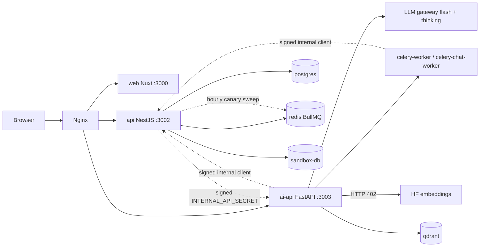

# Competition Current-State Audit (.id DeveloperDay 2026)

> **Status**: `in-progress` · **Owner**: `architect` · **Last reviewed**: `2026-10-17`
>
> What the running ReduCera tree proves today, what it only claims, and the five tasks that raise the competition score before the 25 October 2026 deadline.

The audit ran on branch `main`, last commit `39db220` (2026-10-12), against the Docker dev stack (`POSTGRES_PORT=5434 WEB_PORT=3001`). Source of truth order: current source and runtime, then schema and executable tests, then the latest dated audit and ADRs, then older documents. Nothing in the repository was staged, committed or reset.

---

## Scope

Audited: the learning loop (mastery, review, strategy, companion, grading), the marketplace and creator loop, the prompt registry and its evaluation path, the circularity measurement, the repository gates and the dev stack. Not audited: production deployment (none exists in the repository), payment provider behavior beyond the manual adapter, the 29 unreferenced components of the 2026-10-12 audit.

Working tree condition at the start:

| Item | Value |
|---|---|
| Last commit | `39db220`, 2026-10-12 |
| Tracked files changed since | 330 (10361 insertions, 5356 deletions) |
| Untracked files | 254 paths (351 files in the safety archive) |
| Where the work sits | `services/api` 266 paths, `apps/web` 207, `services/ai-api` 76, `docs` 20 |
| Safety copy | `worktree-tracked.patch` and `worktree-untracked.tgz` in the session scratchpad, outside the repository |

Five days of work are uncommitted. This is finding CP-14.

---

## Baseline gates (this session)

Every command ran in the `tools` profile. No command ran on the host.

| Gate | Command | Result |
|---|---|---|
| Ownership rules | `repo-tools bash scripts/check-ownership-rules.sh` | PASS |
| Theme sync | `repo-tools bash infra/scripts/check-theme-sync.sh` | OK, both themes |
| Compose env | `repo-tools python scripts/check-compose-env.py` | exit 0 |
| Compose config | `docker compose config`, `docker compose -f docker-compose.prod.yml config` | both exit 0 |
| API typecheck | `api-tools pnpm exec tsc --noEmit` | exit 0 |
| API tests | `api-tools pnpm jest --runInBand --silent` on `reducera_ls_scratch` | 246 suites passed, 1 skipped; 3379 tests passed, 5 skipped, 0 failed (151 s) |
| AI API tests | `ai-tools pytest -q` | 1125 passed (30 s) |
| Web tests | `web-tools pnpm test` | 77 files, 985 tests passed (13 s) |
| Stack health | `docker compose ps` | 10 services healthy |
| Edge | `curl` nginx-health, `/api/v1/docs`, `/` | 200, 200, 200 |
| LLM gateway | minimal call, flash `mistral-small-latest` and thinking `magistral-medium-latest` | HTTP 200 for both, token usage reported (22 in, 2 out), 639 ms and 731 ms |
| Embeddings | `build_embedding_model().get_text_embedding(...)` inside `ai-api` | `BLOCKED_EXTERNAL_DEPENDENCY`: HTTP 402 from Hugging Face (still so; the dev stack has used a local embedding provider since 2026-10-17, ADR-030) |

Not run in this phase: migration drift check (`migrate diff`), a browser run, a live HTTP flow. They move to task T1 because they need the demo account.

---

## Findings

Severity: Critical breaks a promised loop for every user, High blocks a competition claim, Medium weakens it, Low is hygiene.

| ID | Sev | Finding | Impact on the competition | Status |
|---|---|---|---|---|
| CP-01 | High | The Python evaluation package is not wired and cannot be trusted. `BenchmarkRunner` fabricates a plausible tutor answer when no output factory is given (fixed text, `prompt_version="unknown-v0"`, `cost_usd=0.001`). The evaluator scores by string heuristics: `_calculation_score` returns 1.0 on both branches, `_double_entry_score` returns 1.0 when neither keyword appears, pedagogy is a word count, misconception handling is 0.8 unless the word "misconception" appears. Calibration rounds 0..1 scores to integers before Cohen's kappa. | Any pass it produced would be a false pass. It must not feed a claim. | Open |
| CP-02 | High | No frozen benchmark exists in the database: `EvaluationDataset` has 0 rows. The 54 scenarios sit in `v1/evaluation/benchmark.py` as Python objects whose expected concepts are underscore slugs (`double_entry`) matched with `\b` against Indonesian prose, so a real answer would score zero. The 2026-10-12 audit names `prisma/seed-data/golden-scenarios.json`; that file does not exist. | The central technical differentiator has no data. | Closed 2026-10-17 for the live path: `tutor-chat-benchmark-v1` (56 cases) and `tutor-chat-dev-v1` (24 cases) are frozen rows with a SHA-256, see [ADR-029](../decisions/ADR-029-offline-benchmark-judge-and-development-set.md). The unwired Python package stays unused. |
| CP-03 | High | The acceptance gate marks `correctness`, `pedagogy` and `hallucination_rate` as `NOT_MEASURED` by construction. A candidate can pass on latency, token and learner-outcome proxies alone. | No measured quality evidence in a "self-improving" claim. | Partly closed 2026-10-17: with a completed benchmark run the gate measures `offline_correctness`, `offline_citation_faithfulness`, `offline_safety` and a rubric judge score; judge calibration and hallucination rate are still `NOT_MEASURED`. |
| CP-04 | High | No real candidate cycle has run. The only `PromptVersion` is `tutor-chat@1`, `ROLLED_BACK`; the audit trail holds three fixture entries ("uji jalur registry end to end", "uji kill switch", "Uji tampilan perubahan"). An AI proposal needs 30 measured turns of the baseline and the dev database has 6 of `tutor-chat-builtin-3`. | The proposal button cannot run on real evidence. | Partly closed 2026-10-17: a proposal can be made from a development-set run (`POST /admin/optimization/benchmarks/{id}/propose-improvement`) and was run once on the dev stack; no candidate has been through a canary yet. |
| CP-05 | High | `ProductConceptLink` has 0 rows. The only `PUBLISHED` product is the free class "Akuntansi Dasar untuk Pemula" with no tag, so every recommendation on dev is the new-arrival fallback. | The circular claim (mastered concept leads to relevant creator content) has no data behind it. | Partly closed 2026-10-17: one class tagged through the author flow and approved by an administrator (T1), the shelf shows it as personalized for the matching learner; one product and one tag are still thin data |
| CP-06 | Medium | The paid creator loop is unproven on dev: 9 orders, all `FULFILLED`, 0 `CreatorEarning`. The only published class is free. The paid path is covered by scratch-database integration specs only. | Keep the economic claim to what the specs show, or add a priced demo product. | Open |
| CP-07 | Medium | Strategy-outcome attribution is thin: 17 `ASSESSMENT_COMPLETED` events, 1 `StrategyOutcome`. `attribute` returns `false` without a same-concept tutor turn in the last 24 hours, and the injection is `@Optional()` in `QuizAttemptsService`, so a mis-wired module skips attribution without an error. `success` means the score rose, with no control arm. | "Checks whether the strategy worked" must be worded as observed change, not effect. | Open; T1 recorded one live attribution (real tutor turn, then graded quiz); a browser run on 2026-10-17 added a second row under `tutor-chat-builtin-4` (2 rows, 1 learner, no control arm) |
| CP-08 | Medium | Evidence needs an `APPROVED` curriculum link. "Akuntansi Dasar — Golden Graph" has 13 and one quiz; "Akuntansi Usaha Dagang" has 0 (3 `PROPOSED`); "Dasar Basis Data dan SQL" has 0. | The demo must run on the Golden Graph course. | Open |
| CP-09 | Medium | No circularity or reuse metric existed: no route, no page, no job. | The impact plan had no auditable numbers. | Closed 2026-10-17 (T4): five component metrics in `GET /admin/metrics/circularity` and the page `/admin/metrics`, with formulas, windows, sample sizes and a "not enough evidence" state ([04](./04-impact-and-circularity-metrics.md)). The dev database holds demo fixtures only, so every metric reads "not enough evidence"; the `OK` branch is covered by specs, not by live data |
| CP-10 | Medium | Semantic retrieval was down (Hugging Face Inference, HTTP 402). Lexical, topic-record and web paths still answered. | Do not state retrieval quality. Disclose the fallback. | Closed for the dev stack 2026-10-17 by a local CPU embedding provider ([ADR-030](../decisions/ADR-030-local-embedding-provider.md)): the same `bge-m3`, 65 outline chunks indexed, chat retrieval returns 10 chunks, lesson introductions cite sources "cocok makna". Retrieval quality is not measured and chat replies still carry no citation markers (the indexed chunks have no lesson id). Hugging Face Inference stays without credit |
| CP-11 | Medium | No automated browser test exists (no Playwright config in the repository). Browser checks are manual through the Playwright MCP. | The end-to-end proof has to be a database-backed API-boundary spec plus a recorded manual run. | Open |
| CP-12 | Low | The AI credit loop is not closed: `ai-api` holds no reserve, spend or settle call. | Leave it out of every "implemented" claim. | Open (A-12) |
| CP-13 | High | The `.id` domain rule is known since 2026-10-17: the body of the accordion, present in the page data, reads "Seluruh produk wajib menggunakan domain .id — baik sebagai situs utama, landing page, situs organisasi, maupun subdomain resmi." under the heading "Syarat teknis yang menentukan keabsahan karya". No `.id` hostname appears anywhere in the repository and the stack runs at `http://localhost`. The exact pass test is not stated. | A validity condition: the entry can be invalid without a `.id` host. Needs an organizer answer, an owner decision and a deployment plan ([07](./07-submission-checklist.md) section 2). | Open, owner |
| CP-14 | High | Five days of work are uncommitted. | One disk failure or a wrong `git checkout` loses it. | Open, owner |
| CP-15 | Low | Documentation drift: the 2026-10-12 audit cites a missing benchmark file; `AGENTS.md` mentions `docker-compose.build.yml`, which does not exist; `docs/progress-tracker.md` links old audit paths. | Judges and teammates read stale pointers. | Open |

Confirmed good, with evidence in the next sections: server-side grading, append-only learning events, API-owned mastery fold, `APPROVED`-only recommendations with an honest `personalized` flag, human-only prompt activation, kill switch and rollback state table, signed service identity, frozen-dataset trigger.

---

## Reconciled claims

| Claim | Where it came from | Verdict |
|---|---|---|
| Deadline 25 October 2026, team of at most three, English PDF of at most 15 pages and 20 MB, 13 required sections, video of at most 5 minutes | Pasted brief | Confirmed on `https://developerday.id/` on 2026-10-17 |
| Student weights 15/15/15/30/25 | Pasted brief | Confirmed on the same page |
| Education (Inclusions & Community Services) weights 25/30/25/20 | Pasted brief | Confirmed |
| `.id` domain obligation | Pasted brief | Confirmed with its body on 2026-10-17 (read from the page data): every product must use a `.id` domain as main site, landing page, organisation site or official subdomain; the pass test is not stated |
| "50-scenario" benchmark | 2026-10-12 audit | 54 scenarios existed in code and 0 in the database; since 2026-10-17 the database holds a 56-case frozen benchmark and a 24-case development set |
| Mistral gateway and model router | Pasted brief | Confirmed: flash `mistral-small-latest`, thinking `magistral-medium-latest`, one OpenAI-compatible gateway |
| Prompt governance building blocks | Pasted brief | Confirmed in the TypeScript registry, not in the Python `v1/optimization` package (unwired duplicate) |
| Event-sourced mastery, strategy outcome, review, concept-linked products | Pasted brief | Confirmed at component level, thin live data |

---

## Architecture map (actual runtime)

Solid edges were exercised this session or by this session's test runs. Dashed edges are claimed by code or older reports and not re-run live yet.

Ownership held in every check: `api` has no LLM or Qdrant client, `ai-api` has no database URL (`check-ownership-rules.sh` PASS).

### Duplicate or competing state authorities

| Authority | Wired owner | Unwired duplicate | Decision |
|---|---|---|---|
| Prompt registry, canary, rollback, acceptance gate | `services/api/src/v1/optimization/` | `services/ai-api/v1/optimization/` (imported by no other module) | Keep as reference (Q-05). Do not extend. |
| Evaluator, benchmark, calibration | none | `services/ai-api/v1/evaluation/` (imported by no other module) | Do not use for any claim. Build the real harness on the live path (T2). |
| Mastery and policy | `services/api/src/v1/learner-model/` | `services/ai-api/v1/learner_model/` types used by prompt rendering only | One mastery holds (ADR-010). |

---

## Feature proof matrix

States: `VERIFIED_E2E` (live stack, browser or HTTP, this session), `VERIFIED_COMPONENT` (executable test on the real boundary, or older dated live report), `PARTIAL`, `UNWIRED`, `BROKEN`, `NOT_VERIFIED`, `NOT_IMPLEMENTED`. Rows marked `VERIFIED_E2E` below were run on 2026-10-17 in T1 (one demo path on the dev stack with fixture learners, see T1).

| Feature | User value | Source | Route | Table or event | Test | Live proof | State | Importance | Next action |
|---|---|---|---|---|---|---|---|---|---|
| Learner mastery from graded evidence | The next step reflects what the learner showed | `learner-model/events/learner-events.service.ts`, `mastery/mastery-v1.ts` | `GET /learner-model/me/mastery`, `/me/next` | `LearningEvent` (17), `ConceptMastery` (8 rows, 4 users) | `quiz-evidence.int.spec.ts`, `demo-path.int.spec.ts` | T1 run: 0.3995 to 0.5346 after a graded quiz, event `5037e699-3c8b-4f2d-877d-3e80e8a8d654` | `VERIFIED_E2E` | Critical | none |
| Server-graded practice | Result cannot be faked | `quiz/quiz-attempts/quiz-attempts.service.ts:100-336` | `POST /quiz/quiz-attempts` submit | `QuizAttempt`, `Answer`, event key `assessment:{attemptId}:{conceptId}` | int specs, `answer-key` specs, `demo-path.int.spec.ts` | T1 run: score 100, answer key not in the questions route, second submit 409 | `VERIFIED_E2E` | Critical | none |
| Strategy outcome | Records whether a teaching move helped | `learner-model/strategy/strategy-outcome.service.ts:32-72` | `GET /learner-model/me/strategy` | `StrategyOutcome` (1) | `strategy-outcome.int.spec.ts`, `demo-path.int.spec.ts` | T1 run: real tutor turn (`GUIDED_EXAMPLE`), then graded quiz, row `1af3c5f8-838b-4c9c-9718-d6d970ae22a9`, delta +0.135 | `VERIFIED_E2E`, one row, no control arm (CP-07) | High | more live turns |
| Microlearning plan and review schedule | Short activities and due reviews | `learner-model/review/review-schedule.ts`, `strategy/microlearning.ts` | `GET /learner-model/me/review` | derived from `ConceptMastery` | review specs, `demo-path.int.spec.ts` | T1 run: due `RELEARN` before the quiz, upcoming in 1.6 days after | `VERIFIED_E2E` | High | none |
| AI companion with citations | Answers cite real sources | `ai-api/v1/learning/{workers,citations}.py`, `chat_template.py`, `config/local_embedding.py` | `POST /ai/v1/learning/chat` | `Episode`, `DecisionTrace` | pytest 1224 | T1 run: reply in 6.5 s with `citations: []` (retrieval then answered 402). After ADR-030: chat worker `[RETRIEVE] returned=10`, turn in 6.0 s, still no citation markers; lesson introduction cites 4 sources incl. one "cocok makna" | reply `VERIFIED_E2E`, lesson-introduction citations `VERIFIED_E2E`, chat citation markers not shown (`VERIFIED_COMPONENT` in the benchmark with fixed sources) | Critical | index lesson-bound material |
| Marketplace concept recommendation | Relevant creator content | `marketplace/recommendation-ranking.ts`, `marketplace-discovery.service.ts:168-247` | `GET /marketplace-discovery/recommendations` | `ProductConceptLink` (1 approved) | `marketplace-discovery.service.spec.ts`, `demo-path.int.spec.ts` | T1 run: `personalized: true`, "penguasaanmu baru 40%", then 53%; browser at 375, 768, 1280 | `VERIFIED_E2E` | Critical | more tagged products |
| Honest fallback label | New arrival is not "personalized" | same, `NEW_ARRIVAL_REASON`, `personalized:false`; `RecommendedShelf.vue:22` | same | none | spec, `demo-path.int.spec.ts` | T1 run: a learner with a need of no tagged product sees "Terbaru di marketplace." | `VERIFIED_E2E` | High | none |
| Creator eligibility gate | Only mastered learners publish | `teacher/applications/applications.service.ts:46` | `POST /teacher/applications` | `MASTERY_THRESHOLD_NOT_MET` | `applications.security.spec.ts` | T1 run: application of a learner with fixture mastery 0.888 on 10 of 10 concepts approved, tenant provisioned | `VERIFIED_E2E` | High | none |
| Creator publishing and moderation | Reusable knowledge | `articles`, `classes`, moderation services, state tables | admin moderation routes | `Article`, `ClassProduct` (1 published) | int specs, `demo-path.int.spec.ts` | T1 run: class created, tagged, submitted, approved, audit rows `CLASS_CREATED`, `CLASS_SUBMITTED`, `CLASS_APPROVED` | `VERIFIED_E2E` | High | none |
| Paid order to creator earning | Creator value | `payments`, `commerce`, `ledger` | `/orders`, `/payments` | `CreatorEarning` (0) | `payment-flow.int.spec.ts` and others | none on dev | `VERIFIED_COMPONENT` on scratch only (CP-06) | Medium | Use a priced product only if time allows |
| Prompt proposal from evidence | Draft from measured failures | `optimization/prompt-proposal.service.ts`, `ai-api/v1/prompt_proposals/` | `POST /admin/optimization/prompts/propose-improvement` | `PromptVersion` (1) | `prompt-proposal.service.spec.ts` | refused: 6 < 30 turns | `PARTIAL` (CP-04) | High | T3: accept benchmark failures as evidence |
| Frozen benchmark | Same cases for baseline and candidate | `EvaluationDataset`, trigger `evaluation_dataset_frozen_guard` | none | 0 rows | trigger test in registry int spec | none | Frozen 2026-10-17 (CP-02), `VERIFIED_LIVE` for the A/A and candidate runs | Critical | T2 done |
| Independent judge and calibration | Measured quality | `ai-api/v1/benchmark/` (the old `v1/evaluation/*` stays unwired, CP-01) | `POST /admin/optimization/benchmarks` | `OptimizationRun` | `v1/benchmark/__tests__`, `benchmark-run.int.spec.ts` | A/A run and candidate run on the dev stack | Judge built 2026-10-17; calibration `NOT_MEASURED` until human labels exist | Critical | T2 done, labels open |
| Acceptance gate | Rejects regressions | `optimization/acceptance-gate.ts` | `POST /admin/optimization/prompts/:id/evaluate` | `PromptVersion.metricsJson` | `acceptance-gate.spec.ts` | fixture only | `VERIFIED_COMPONENT`, quality criteria `NOT_MEASURED` (CP-03) | Critical | T3 |
| Canary, human approval, rollback, kill switch | Reversible rollout | `prompt-registry.service.ts:173-400`, `prompt-state.ts` | `/admin/optimization/prompts/:id/{canary,approve,reject,rollback}` | `PromptVersion`, `AuditLog` | `prompt-registry.int.spec.ts` | one fixture rollback | `VERIFIED_COMPONENT` | High | T3 re-run on a real candidate |
| Hourly canary sweep | Auto rollback on regression | `prompt-evaluation.{scheduler,processor}.ts` | queue `prompt-evaluation` | Redis repeatable job | `prompt-evaluation.spec.ts` | dated report | `VERIFIED_COMPONENT` | Medium | none |
| Circularity metrics | Auditable impact | `v1/circularity/circularity-metrics{,.service}.ts`, `apps/web/app/pages/admin/metrics.vue` | `GET /admin/metrics/circularity`, `/admin/metrics` | derived from `LearningEvent`, `ConceptMastery`, `ProductConceptLink`, `Entitlement`, `TeacherApplication`, `PromptVersion`, `OptimizationRun`, `StrategyOutcome` | `circularity-metrics.spec.ts`, `admin-circularity.controller.spec.ts`, `circularity-metrics.int.spec.ts`, `circularity.test.ts` | browser 375, 768, 1280 px, light, dark, zero console errors; route 403 learner, 401 anonymous, 200 admin | `VERIFIED_E2E` (panel and route); values are demo fixtures and read "not enough evidence" | High | real learners |
| AI credit spend | Closed credit loop | `ai-credits` internal controller only | none | none | none | none | `NOT_IMPLEMENTED` (CP-12) | Low | Omit from claims |
| Browser E2E automation | Regression proof | none | none | none | none | manual MCP only | `NOT_IMPLEMENTED` (CP-11) | Medium | T1 spec at API boundary |

---

## Competition scorecard

Target: Student track first, weights Uniqueness 15, Proof of concept 15, Features 15, Technology quality 30, Presentation 25 (checked on the official page). The Education track weights Market potential at 30 and Presentation is not listed separately. The category and whether the team qualifies as students is an owner decision (CP-13 family).

Ranking uses competition impact x gap severity x probability of finishing, divided by engineering risk, each on a 1 to 5 scale. The scores are judgment, not measurement.

| Task | Hits (Student weights) | Impact | Gap | Prob. | Risk | Score |
|---|---|---|---|---|---|---|
| T1 Demo path proven live and covered by a database-backed spec | PoC 15, Features 15, Presentation 25 | 5 | 4 | 4 | 2 | 40 |
| T2 Frozen benchmark and real baseline run with independent evaluation | Technology 30, Uniqueness 15 | 5 | 5 | 3 | 3 | 25 |
| T4 Circularity metrics panel (at most five, with formulas) | PoC 15, Presentation 25 | 3 | 4 | 4 | 2 | 24 |
| T3 Gate, AI draft and canary cycle on benchmark evidence | Technology 30, Uniqueness 15 | 4 | 4 | 3 | 3 | 16 |
| T5 Competition deliverables (docs 01 to 07, paper, script, checklist) | Presentation 25 | 5 | 4 | 5 | 1 | fixed cost |

Execution order: T1, T2, T3, T4, T5. T3 comes before T4 because it needs T2 and carries the main differentiator; T5 runs alongside and closes last.

---

## Prioritized tasks

### T1. One demo path, proven live and under a regression spec

Status 2026-10-17: built and run. The fixture learners hold mastery appended through `LearnerEventsService` (demo fixtures, not real study): `t1.creator` has 12 strong events on each of the 10 concepts of the course, `t1.learner` has 8 strong events on `l1-t01-accounting-equation` and 2 weak ones on `l1-t02-debits-credits`, `t1.learner2` has 2 weak ones on `l1-t12-source-documents`. Everything else ran through the HTTP routes of the dev stack:

- Creator: application `1bc7392a-4be6-499b-9793-4ee2c3f3acc0` approved by an administrator (request `7946b312-0222-40a8-8f01-545284914683`, audit `TENANT_CREATED`, `USER_ROLE_CHANGED`), class `bb6a6c14-968a-4c94-8f89-4ee799a8a973` created with the tag `l1-t02-debits-credits` (`PROPOSED`), submitted, approved through `POST /admin/classes/:id/approve` (the tag became `APPROVED`).
- Learner before the class: next concept `l1-t02-debits-credits` with `CONTINUE_PRACTICE`, a due `RELEARN` review with retrievability 0.329, an empty shelf (no product). After the approval: the shelf shows the class with `personalized: true` and "Membahas "Debits and Credits", penguasaanmu baru 40%" (request `b1fff460-47c9-489b-9cf5-7a5509593bd6`). The second learner got the same class labelled "Terbaru di marketplace." and `personalized: false` (request `f2df1038-3535-41d7-a339-44755cc9a794`).
- Companion: message `8e45ee9a-f6d1-456a-be25-5dfd565c1636` answered in 6.5 s; the `Episode` `eb062fb1-364a-4a22-9740-13b26e68c4af` stores `GUIDED_EXAMPLE` for `l1-t02-debits-credits`. Retrieval answered 402 (CP-10), so the reply carried `citations: []`: the citation criterion is not shown live, only by the benchmark with fixed sources.
- Quiz: attempt `f89afa0c-ca33-4af7-b3e4-923609ff1dca` scored 100 on a quiz whose route does not expose the answer key; `LearningEvent` `5037e699-3c8b-4f2d-877d-3e80e8a8d654` (stream sequence 11, key `assessment:{attemptId}:{conceptId}`); mastery 0.3995 to 0.5346 with 3 events (one good quiz after two weak ones does not pass the concept); `StrategyOutcome` `1af3c5f8-838b-4c9c-9718-d6d970ae22a9` (`GUIDED_EXAMPLE`, delta +0.135, success); a second submit answered 409 and appended nothing; the due review moved to "upcoming in 1.6 days"; the shelf now says 53%.
- Browser (new contexts, learner session): shelf, class page, mastery page and lesson page at 375, 768 and 1280 px, light and dark, reduced motion, no horizontal overflow, no console error.
- Regression spec: `services/api/src/v1/__tests__/demo-path.int.spec.ts` (3 tests on the scratch database) runs the same sequence at the service boundary, including `LearnerEventsService.rebuild` equal to the stored projection.
- Found on the way: the live reply said "Tadi kamu sudah benar menaruh kas di debit, jangan ragu lagi!" to a learner who had said nothing of the kind, the example sentence of the builtin template copied verbatim (see [ADR-029](../decisions/ADR-029-offline-benchmark-judge-and-development-set.md) addendum).

Decision: course "Akuntansi Dasar — Golden Graph" (13 `APPROVED` concept links, 1 quiz), product "Akuntansi Dasar untuk Pemula" (published, free), a dedicated demo learner, a creator and an administrator created for the demo.

Acceptance criteria:

- The class receives concept tags through the author flow and is approved by an administrator through the moderation route (no database edit, no AI approval).
- A demo learner with persisted mastery sees a next need or a due review with the real reason code, asks the companion a question, and every citation shown resolves to a returned source.
- The learner submits the practice quiz; the API grades it; a `LearningEvent` is appended; `ConceptMastery` changes by the `mastery-v1` rule; a `StrategyOutcome` exists when a same-concept tutor turn precedes the quiz; a duplicate submit appends nothing.
- After a reload the next need or review reflects the new state, read from the database.
- The marketplace shelf shows the approved product with `personalized: true` and the matched concept; a learner with no matching need sees only fallbacks labelled "Terbaru di marketplace".
- One new `*.int.spec.ts` runs the same sequence at the service boundary on the scratch database.

Evidence to keep: request ids, the `LearningEvent` and `StrategyOutcome` row ids, before and after mastery, screenshots under `.playwright-mcp/` at 375, 768 and 1280 in light and dark.

### T2. Frozen benchmark and real evaluation

Status 2026-10-17: built, see [ADR-029](../decisions/ADR-029-offline-benchmark-judge-and-development-set.md). Done: frozen dataset with hash and trigger test, stable case format, runner on the live router with one run record per sample, deterministic checks, a rubric judge on a different model and prompt, "not calibrated" shown, no cost figure. Not done: the human-label sheet and any kappa, and a second reviewer of the cases (both datasets are `AUTHOR_DRAFT`).

Acceptance criteria:

- A versioned dataset of at least 50 cases is stored in `EvaluationDataset` with `isFrozen = true` and a content hash; the existing trigger blocks edits; a test proves an update and a delete fail.
- Each case has a stable id, category, risk class, input, fixed source records, required and forbidden facts with surface-form variants, citation constraints and a behavior constraint (answer, refuse, say no evidence).
- A runner calls the live model router with the active template and with a candidate on exactly the same cases and stores prompt label, model id, dataset hash, run id, response, raw citations, token usage, latency and timestamp. No default output factory exists in the live path.
- Evaluation is separate from the tutor: deterministic checks (required and forbidden facts, citation ids against the supplied sources, answer-key and protected-policy leakage), a rubric judge on a different model and prompt, and a human-label sheet for calibration. Output is per dimension and per case, with counts.
- Calibration prints "not calibrated" until the owner supplies labels. No kappa is claimed without enough labelled items.
- Cost shows "unpriced" because no verified price table exists.

### T3. Governed candidate cycle on benchmark evidence

Status 2026-10-17: built, see [ADR-029](../decisions/ADR-029-offline-benchmark-judge-and-development-set.md). Done: offline criteria in the gate (a failed one blocks `startCanary`, an inconclusive one does not, an offline failure never rolls back a running canary), a proposer fed only by the development set that writes a `DRAFT`, one real proposal and one real candidate run on the dev stack. The admin page (`Benchmark offline` panel on `/admin/optimization`) shows the per-dimension result next to the gate criteria; checked in a browser at 375, 768 and 1280 px, light and dark, reduced motion, zero console errors. Not done: a canary of a benchmarked candidate on real traffic.

Acceptance criteria:

- The acceptance gate takes the offline comparison as evidence for `correctness`, `pedagogy` and `hallucination_rate` (renamed in the report to what is measured) and fails closed on any safety, correctness or citation regression.
- The AI proposer accepts benchmark failures as redacted evidence and writes only a `DRAFT` with parent version, rationale, evidence ids and diff; tests show the AI path cannot approve, start a canary or activate.
- Starting a canary and activating stay human-only (`ADMIN`); the kill switch blocks candidate routing; a regression rolls back and writes an audit row, all on a scratch or dev stack.
- The admin page shows the per-dimension benchmark result next to the gate criteria.

### T4. Circularity and learning metrics, at most five

Status 2026-10-17: built, see [04](./04-impact-and-circularity-metrics.md). Five metrics, each with its formula, sources, window, sample size, minimum and "not enough evidence" state, are computed read-only by the API (`GET /admin/metrics/circularity`, role `ADMIN`) and shown on `/admin/metrics`; demo accounts (`@reducera.local`) are counted apart and labelled "Akun demo (fixture), bukan hasil". Verified: 22 + 8 unit and controller tests, 1 integration spec on the scratch database, 11 web tests, the live route (learner 403, anonymous 401, bad window 422) and the page in a browser. Not done: organic data (none exists, so no metric reaches `OK` on the dev stack), a time series, export.

Acceptance criteria: each metric has a formula, source tables, window, sample size and a "not enough evidence" state: mastery change after a graded activity, outcome of a scheduled review, knowledge reuse (published concept-linked products used by at least two distinct learners in a window), learner-to-creator conversion over a defined eligible cohort, and prompt improvement evidence. No page views, clicks or time-on-app. Fixtures, if used, are labelled as demo fixtures.

### T5. Deliverables

`docs/competition/01` to `07` and the paper outline, with verified facts only, statuses taken from this matrix, and the submission checklist (domain, category, team, links).

Status 2026-10-17: the seven documents exist: [01 positioning](./01-winning-positioning.md) (claims `CL-01` to `CL-16`), [02 demo flow and evidence](./02-demo-flow-and-evidence.md), [03 evaluation report](./03-evaluation-report.md), [04 metrics](./04-impact-and-circularity-metrics.md), [05 paper outline](./05-paper-outline.md), [06 demo script](./06-five-minute-demo-script.md) and [07 submission checklist](./07-submission-checklist.md). What they do not contain, on purpose: team names and contacts, a category decision, a `.id` host, market figures, results of a pilot. What was found while writing them: the `.id` rule body (CP-13); the real first-lesson path of a new learner (course, learning style, introduction with numbered sources and a degraded-search notice, path quiz, seven generated steps) runs in the browser; the path quiz writes no mastery evidence; the fixture steps of T1 have no generated material and one old chat still shows the invented praise, so the recording needs its own account (02 section 7); the admin pages for applications, moderation and audit were walked in a browser. Not done: the paper text, the video, the recording account, the metrics route (T4).

---

## Decisions and blockers for the owner

| Item | Why it waits |
|---|---|
| Commit the working tree (CP-14) | Git writes are the owner's. |
| Category and Student eligibility | The team decides and confirms in the portal. |
| `.id` domain rule (CP-13) | The rule text is known; the pass test and a hostname plan are not ([07](./07-submission-checklist.md) section 2). |
| Whether the competition host keeps the local embedding provider (a 2.3 GB model directory) or buys Hugging Face credit (CP-10) | Budget and host size. |
| Human labels for the judge, at least 20 items, high-risk cases first | Only a person can label. |
| LLM budget for the benchmark | T2 will make about 54 cases x 2 prompts x (answer + judge) = 216 calls on the flash and thinking models, a few hundred thousand tokens. Confirm the gateway quota. |
| Price table (A-12 family) | Without it cost stays "unpriced". |
| Whether to delete the unwired Python `v1/evaluation` and `v1/optimization` | Q-05 keeps them as reference. |

---

## Evidence citations

- Fabricated benchmark output: `services/ai-api/v1/evaluation/runner.py:73`, `:125-140`
- Heuristic scoring: `services/ai-api/v1/evaluation/evaluator.py:254`, `:276`, `:281`, `:313`
- Rounded kappa: `services/ai-api/v1/evaluation/calibration.py:102-103`
- Mounted routers only: `services/ai-api/v1/router.py:11-14`
- Unwired claim: `grep -rnE "v1\.evaluation|v1\.optimization" services/ai-api` outside the two packages returns only their own files
- `NOT_MEASURED` criteria: `services/api/src/v1/optimization/acceptance-gate.ts:20`, `:74`; thresholds `:12-18`
- Frozen guard: `services/api/prisma/migrations/20261012110000_prompt_registry_guards/migration.sql:11-23`; model `services/api/prisma/schema.prisma:1664`
- Proposal threshold: `services/api/src/v1/optimization/prompt-proposal.service.ts:16`, `:69`
- Grading and evidence: `services/api/src/v1/quiz/quiz-attempts/quiz-attempts.service.ts:100-336` (evidence key at `:300`, optional attribution at `:39`, `:312`, silent no-op at `:287`)
- Attribution: `services/api/src/v1/learner-model/strategy/strategy-outcome.service.ts:32-72` (`return false` at `:44`, `success` at `:66`)
- `APPROVED`-only recommendations and fallback: `services/api/src/v1/marketplace/marketplace-discovery.service.ts:168-247` (`:179`, `:19`, `:247`); web heading `apps/web/app/components/marketplace/RecommendedShelf.vue:22`
- Creator gate: `services/api/src/v1/teacher/applications/applications.service.ts:46`
- Registry states and methods: `services/api/src/v1/optimization/prompt-state.ts`, `prompt-registry.service.ts:115`, `:173`, `:210`, `:302-400`; protected phrases `prompt-contracts.ts:13-24`
- Dev database counts (read-only `SELECT`, 2026-10-17): `User` 18, `Concept` 83, approved curriculum links 50, `LearningEvent` 17, `ConceptMastery` 8, `StrategyOutcome` 1, `Episode` 69, `DecisionTrace` 22, `PromptVersion` 1, `EvaluationDataset` 0, `ProductConceptLink` 0, `Order` 9 (all `FULFILLED`), `CreatorEarning` 0
- Official rules: `https://developerday.id/`, fetched 2026-10-17
- Gate logs: session scratchpad `api-gate.log`, `ai-gate.log`, `web-gate.log`

## Verdict

ReduCera has a real, tested learning-evidence core and a governed prompt registry, and the repository gates are green (3379 + 1125 + 985 tests, ownership PASS). It does not yet have the evidence a winning entry needs: the benchmark and independent evaluation are absent (the code that looks like them would produce false passes), no concept-linked product existed to show circular reuse, no circularity metric existed (T1 and T4 added a demo path and a metrics page, both on fixture data), and the live data is thin. The highest-return work is T1 and T2: prove one narrow loop on the running stack, then measure the tutor prompt against a frozen set with real model outputs. Until those exist, the truthful positioning is "evidence-driven learning with a human-governed, reversible prompt-improvement mechanism", with benchmark quality, semantic retrieval quality, paid creator earnings and AI credits stated as pending.
